<!--
  GITHUB PROFILE README — Abdullah Al Fahim (@fahimbro26)
  This file lives in a repository named exactly "fahimbro26" (public) at the repo root.
  Banner and signature images live in /assets (banner.svg, signature.svg).
  Add new projects under "things_ive_built" whenever you publish them.
-->

<!-- ========== HEADER (required: assets/banner.svg) ========== -->
<div align="center">



<!-- Typing animation: edit the text after "lines=". Separate phrases with ";" and use "+" for spaces. -->
<a href="https://github.com/fahimbro26">
  
</a>

</div>

---

## `> about_me`

Hi, I'm **Abdullah Al Fahim** from **Dhaka, Bangladesh**.

Photography is one of my biggest passions, and I love exploring new technology and learning how things work. I build websites, experiments, and small digital projects, and I practice **vibe coding**: turning ideas into working projects with the help of AI tools.

I'm not a senior engineer, and I'm not pretending to be. I'm learning by doing, experimenting a lot, and improving my coding skills with every project. My interests sit around web development, creative technology, and AI-assisted development.

---

## `> how_i_build`

```text
idea  ->  prompt  ->  generate  ->  test  ->  fix  ->  publish
```

1. **Imagine** a useful or creative idea.
2. **Describe** the project requirements to an AI coding assistant.
3. **Generate and review** the code.
4. **Test** the project on mobile and desktop.
5. **Fix bugs** and improve the design.
6. **Publish** suitable projects using GitHub and free hosting platforms.

AI helps me build faster, but I still aim to understand, test, customize, and improve the code it generates.

<div align="center">


</div>

---

## `> tech_stack`

Technologies and tools I use or explore in my projects.

<div align="center">


</div>

---

## `> things_ive_built`

<!--
  OPTIONAL: add more projects here when they are ready, using the same format:

  **Project Name**
  One-line description.
  [Live website](LIVE_LINK) · [Repository](YOUR_REPOSITORY_LINK)
-->

**Fahimography**
My personal photography portfolio.
[Live website](https://fahimbro26.github.io/Fahimography/)

---

## `> github_stats`

<!--
  All cards below use public third-party services configured for username "fahimbro26".
  Nothing here is hand-written data; every number comes from the live GitHub API.
  If a card stops loading, swap its URL:
    - Stats / Top languages: self-host github-readme-stats on your own Vercel account, then replace
      "github-readme-stats.vercel.app" with your deployment domain.
    - Streak: replace "streak-stats.demolab.com" with your own deployment of github-readme-streak-stats.
    - Activity graph: replace "github-readme-activity-graph.vercel.app" with your own deployment, or delete the block.
    - Profile views: komarev.com counts visits by its own service and may differ from GitHub's official analytics.
-->

<div align="center">


<br /><br />


<br />


</div>

---

## `> contribution_graph`

<!-- OPTIONAL: shows real public contribution activity only. Remove this block if the service goes down. -->

<div align="center">


</div>

---

## `> interests`

<div align="center">


</div>

---

## `> photography`

Photography is one of my greatest hobbies. It's how I notice the world, and it keeps my creative side busy alongside the technical one.

<div align="center">

<a href="https://fahimbro26.github.io/Fahimography/">
  
</a>

</div>

---

## `> connect_with_me`

<!-- Social links. Edit the href values only if a link changes. -->

<div align="center">

<a href="https://www.facebook.com/share/19qxk3zgrL/"></a>
<a href="https://youtube.com/@fahims_gk_26?si=lGC3r0_UnxarSI5C"></a>
<a href="https://bd.linkedin.com/in/abdullah-al-fahim-23072b314"></a>
<a href="https://github.com/fahimbro26"></a>
<a href="https://fahimbro26.github.io/Fahimography/"></a>
<a href="https://abdullahalfahim26.blogspot.com"></a>
<a href="mailto:abdullahalfahim895@gmail.com"></a>

</div>

---

## `> philosophy`

> I believe ideas become more valuable when we build, experiment, and keep learning. AI is a tool that helps me explore possibilities, while curiosity drives the process.

---

<!-- ========== SIGNATURE (required: assets/signature.svg) ========== -->
<div align="center">



<sub>— Abdullah Al Fahim | Dhaka, Bangladesh</sub>

</div>
